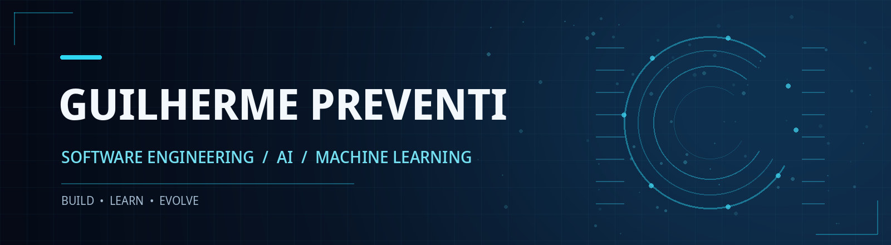

### Olá, eu sou o Guilherme! 👋

**Estudante de Engenharia de Software | Inteligência Artificial & Machine Learning**

Tenho interesse em desenvolver soluções que conectem **engenharia de software, dados e inteligência artificial**, com foco em aprendizado contínuo e aplicações práticas.

---

## 👨‍💻 Sobre mim

- 🎓 Cursando **Engenharia de Software na PUC-Campinas**.
- 💻 Formação técnica em **Desenvolvimento de Sistemas pelo SENAI**.
- 🤖 Participando da **Residência em Inteligência Artificial**, em parceria com o **Instituto Eldorado**.
- 🚀 Interesses em **Machine Learning, agentes de IA, desenvolvimento backend e arquitetura de software**.

## 🛠️ Tecnologias e ferramentas

## 💡 Áreas de interesse

`Engenharia de Software` · `Inteligência Artificial` · `Machine Learning`

`Agentes de IA` · `Desenvolvimento Backend` · `Arquitetura de Software`

---

**Aprendendo, construindo e evoluindo a cada projeto.**

