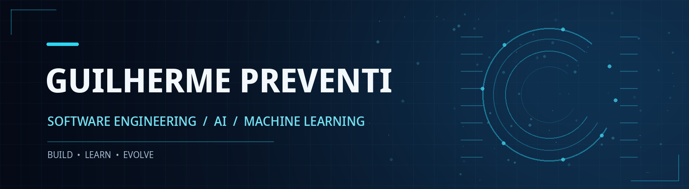

# Olá, eu sou o Guilherme

**Estudante de Engenharia de Software · Inteligência Artificial · Machine Learning**

## Sobre mim

- Curso **Engenharia de Software na PUC-Campinas**.
- Tenho formação técnica em **Desenvolvimento de Sistemas pelo SENAI**.
- Participo da **Residência em Inteligência Artificial**, em parceria com o **Instituto Eldorado**.

Tenho interesse em **desenvolvimento backend**, **arquitetura de software**, **Machine Learning** e **agentes de IA**. Gosto de trabalhar em projetos que conectam software, dados e inteligência artificial.

## Tecnologias e ferramentas

### Backend e linguagens

### Dados e Machine Learning

### Bancos de dados e ferramentas

